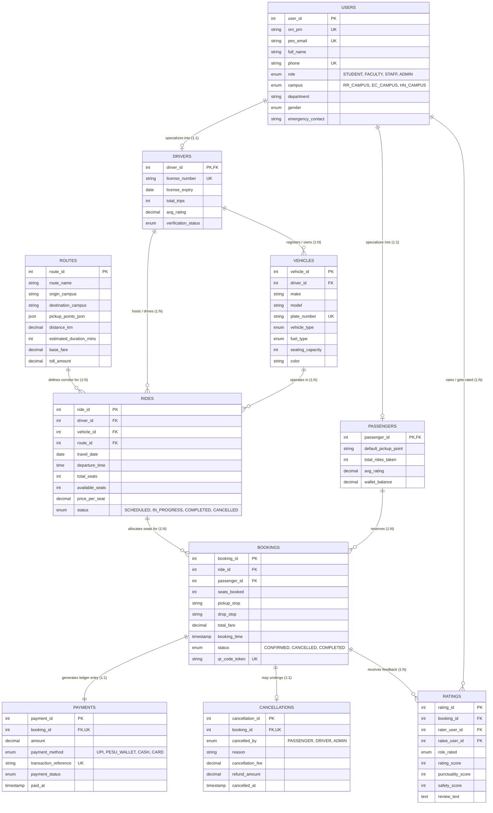

# PESUPool: Intelligent Database-Driven Carpooling & Shared Mobility Platform

> **DBMS Experiential Learning – Level 3 Capstone Project**  
> **Institution:** PES University, Bangalore  
> **Course Instructor:** Dr. Nagasundari S  
> **Architecture Paradigm:** Multi-Model (Relational SQL + Document NoSQL)  
> **Team Members:** **PES1UG24AM121** & **PES1UG24AM078**

---

## 📌 Project Deliverables & Submission Links

- 📄 **Project Report (PDF Version):** [docs/DBMS_Level3_Project_Report_PESUPool.pdf](docs/DBMS_Level3_Project_Report_PESUPool.pdf)
- 📝 **Project Report (DOCX Version):** [docs/DBMS_Level3_Project_Report_PESUPool.docx](docs/DBMS_Level3_Project_Report_PESUPool.docx)
- 📑 **Project Report (Markdown Version):** [docs/DBMS_Level3_Project_Report_PESUPool.md](docs/DBMS_Level3_Project_Report_PESUPool.md)
- 🗄️ **Relational DDL Schema & Triggers:** [sql/01_schema.sql](sql/01_schema.sql)
- 🌱 **Database Population & Seed Data:** [sql/02_seed.sql](sql/02_seed.sql)
- 📊 **Analytical SQL Queries (Reports):** [sql/03_queries.sql](sql/03_queries.sql)
- 🚀 **Interactive Web Application:** Next.js 14 Web Interface at `http://localhost:3000`

---

## 1. Project Synopsis & Motivation

**PESUPool** is a centralized, database-driven campus ride-sharing and shared-mobility platform engineered specifically for the students, faculty, and administrative members of PES University (connecting Ring Road Campus, Electronic City Campus, and prime Bengaluru transit corridors).

Daily commuting across Bengaluru's tech corridors (Outer Ring Road, Silk Board, Hosur Road, Banashankari, and Whitefield) entails extreme vehicular congestion, excessive individual fuel expenditures, and high carbon emissions. Existing commercial ride-hailing services (such as Uber and Ola) impose surge pricing and lack community verification.

PESUPool solves this problem through an intelligent route-matching and reservation engine backed by:
1. **Relational ACID Database (MySQL 8.4):** Guarantees strict transactional consistency for seat reservations, wallet financial ledgers, rating histories, and cascade rules.
2. **Document NoSQL Database (MongoDB):** Streams high-velocity in-transit telemetry (GPS waypoints, vehicle velocities, ETAs) and flexible in-ride communication logs.

---

## 2. Key Objectives & Scope

- **ACID Seat Reservation Engine:** Eliminate double-booking using row-level locking (`FOR UPDATE`) and database triggers.
- **University Community Verification:** Enforce PES University SRN/PRN identity validation and `@pes.edu` institutional email verification.
- **Intelligent Fare & Carbon Offset Calculator:** Compute shared fuel splitting and track avoided carbon emissions ($\approx 0.171\text{ kg CO}_2$ saved per passenger-km).
- **Multi-Role Authorization:** Provide Role-Based Access Control (RBAC) across Students, Faculty, Drivers, and Administrators.
- **Deep DBMS Analytical Intelligence:** Generate operational reports using multi-table `JOIN`, `GROUP BY`, `HAVING`, nested subqueries, and MongoDB aggregation pipelines.

---

## 3. Entity-Relationship (ER) Diagram

The relational schema comprises **10 normalized entities** (exceeding the Level 3 requirement of at least 5 tables):



---

## 4. Database Architecture & Justification

| Database Paradigm | Technology | System Responsibility | Justification |
| :--- | :--- | :--- | :--- |
| **Relational (RDBMS)** | **MySQL 8.4** | Core entities, seat bookings, wallet ledger, ACID transactions | Guarantees atomic seat allocations (`FOR UPDATE`), referential integrity (`FOREIGN KEY`), checks, triggers, and relational analytics (`GROUP BY`, `HAVING`). |
| **Document (NoSQL)** | **MongoDB** | Telemetry coordinates, GPS breadcrumbs, in-ride chat logs | Accommodates schema-free, high-velocity time-series sensor data without database locking overhead. Implements aggregation pipelines (`$group`, `$avg`). |

---

## 5. Advanced Database Concepts Demonstrated (6 Features)

### 1. ACID Transactions (`sp_book_ride` & `sp_cancel_booking`)
- Enforces strict isolation with `START TRANSACTION`, row-level locking (`SELECT ... FOR UPDATE`), and automatic rollback on exception (`DECLARE EXIT HANDLER FOR SQLEXCEPTION`).

### 2. Database Views
- `vw_available_rides`: Denormalizes active scheduled rides with live driver ratings, vehicle make, and route endpoints.
- `vw_driver_performance`: Computes trip completion counts, driver ratings, and total revenue.
- `vw_route_metrics`: Aggregates passenger volumes and occupancy percentages per corridor.
- `vw_user_carbon_savings`: Calculates cumulative km shared and total $\text{kg CO}_2$ avoided.

### 3. Database Triggers
- `trg_prevent_driver_self_booking`: `BEFORE INSERT ON bookings` — blocks drivers from booking seats on their own rides.
- `trg_check_available_seats`: `BEFORE INSERT ON bookings` — prevents overbooking beyond vehicle capacity.
- `trg_after_booking_confirmed`: `AFTER INSERT ON bookings` — atomically decrements remaining ride seats and increments passenger trip stats.
- `trg_after_cancellation_restore_seats`: `AFTER INSERT ON cancellations` — restores available seats to the ride and credits refund to passenger wallet.
- `trg_after_rating_submitted`: `AFTER INSERT ON ratings` — recalculates user rating averages dynamically.

### 4. Stored Procedures
- `sp_book_ride(p_ride_id, p_passenger_id, p_seats, p_pickup, p_drop, p_payment_method, OUT p_booking_id, OUT p_status_msg)`
- `sp_cancel_booking(p_booking_id, p_reason, p_cancelled_by, OUT p_refund_amount, OUT p_status_msg)`
- `sp_generate_campus_report()`

### 5. Indexing Strategy
- B-Tree composite indexes on `(travel_date, status, departure_time)`, `(driver_id, status)`, and `(origin_campus, destination_campus)` for rapid sub-millisecond lookups.

### 6. NoSQL Aggregation Pipeline (MongoDB)
- Groups live GPS telemetry stream by corridor segment to compute average speed vectors and traffic delay offsets:
  ```javascript
  db.ride_telemetry.aggregate([
    { $group: { _id: "$current_segment", avg_speed_kmph: { $avg: "$speed_kmph" }, ping_count: { $sum: 1 }, avg_delay_mins: { $avg: "$estimated_delay_mins" } } },
    { $sort: { ping_count: -1 } }
  ])
  ```

---

## 6. Analytical Queries & Reports (Demonstration Suite)

1. **Department Mobility, Financial Savings & Carbon Offset Report:**
   Evaluates average commute costs by department and financial savings compared to commercial cabs ($\approx\text{₹}22/\text{km}$):
   - **Electronics & Comm:** ₹1,080.40 saved, 10.81 kg $\text{CO}_2$ offset
   - **AI & Machine Learning:** ₹898.00 saved, 8.38 kg $\text{CO}_2$ offset
   - **Mechanical Engineering:** ₹652.20 saved, 6.86 kg $\text{CO}_2$ offset
2. **Route Occupancy and Revenue Analysis (`GROUP BY`, `HAVING`):**
   Ranks campus corridors by total passenger bookings and gross revenue.
3. **Peak Commuter Departure Hours Analysis (`EXTRACT(HOUR ...)`):**
   Identifies morning lecture rush (08:00 - 09:00) with 12 commuters carpooling.
4. **Driver Safety & Punctuality Leaderboard (`HAVING avg_rating >= 4.50`):**
   Multi-table join across drivers, vehicles, rides, bookings, and ratings.
5. **Above-Campus-Average Earners (Nested Subquery):**
   Filters drivers earning above the campus mean using subquery aggregation.
6. **Cancellation & Revenue Impact Breakdown:**
   Categorizes reasons for trip cancellation and automated refund disbursements.
7. **MongoDB NoSQL Telemetry Aggregation:**
   Aggregates live sensor telemetry by roadway segment.

---

## 7. Quick Setup & Execution Instructions

### Prerequisites
- Node.js v18+ (v20 LTS recommended)
- MySQL Server 8.4 (configured on port 3307 or 3306)

### One-Click Launch
1. **Start Dedicated MySQL Server:**
   ```powershell
   powershell -ExecutionPolicy Bypass -File .\scripts\start-db.ps1
   ```
2. **Execute Schema & Seed Data:**
   ```powershell
   powershell -ExecutionPolicy Bypass -File .\scripts\init-db.ps1
   ```
3. **Launch the Next.js Web Interface:**
   ```powershell
   npm run start
   ```
   Open **http://localhost:3000** in your browser.

---

## 8. Team Member Contributions & Rubric Mapping

| Team Member | SRN | Institutional Email | Key Responsibilities & Module Ownership |
| :--- | :--- | :--- | :--- |
| **Team Member 1** | **PES1UG24AM121** | pes1ug24am121@pesu.pes.edu | Relational Database Design, ER Modeling, 3NF Normalization Analysis, DDL/DML Schema (`01_schema.sql`, `02_seed.sql`), ACID Stored Procedures (`sp_book_ride`, `sp_cancel_booking`), 5 Database Triggers, and B-Tree Indexing Strategy. |
| **Team Member 2** | **PES1UG24AM078** | pes1ug24am078@pesu.pes.edu | Next.js 14 Fullstack Web Architecture, RESTful API Route Handlers, MongoDB NoSQL Telemetry Pipeline, Geospatial Breadcrumb Tracking, Analytical Queries (`03_queries.sql`), UI/UX Reports Dashboard, and Comprehensive Project Documentation. |
