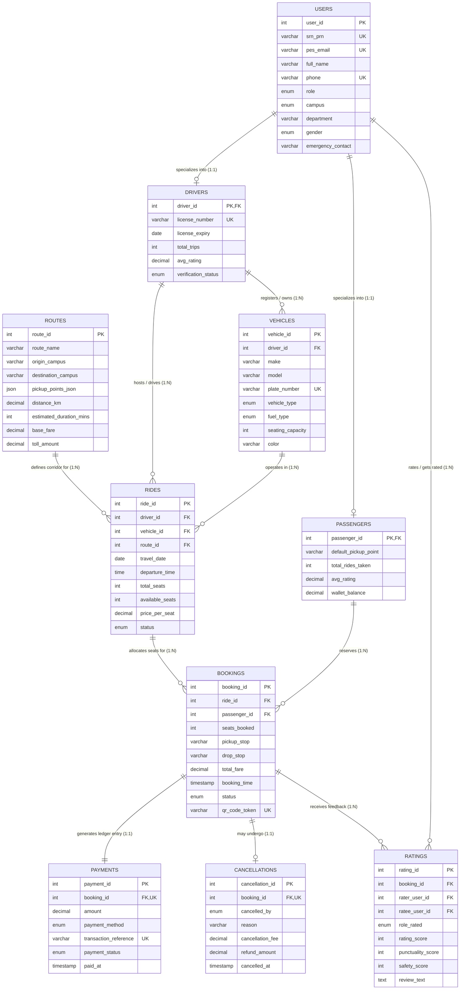

# PESUPool: An Intelligent Database-Driven Carpooling & Shared Mobility Platform
## DBMS Experiential Learning – Level 3 Project Report

---

### **Project Metadata**
- **Course:** Database Management Systems (Experiential Learning – Level 3)
- **Institution:** PES University, Bengaluru
- **Department:** Department of Computer Science and Engineering / AIML
- **Course Instructor:** Dr. Nagasundari S
- **Academic Year:** 2026–2027

### **Team Members**
| Team Member Name | Student Registration Number (SRN) | PES Institutional Email | Assigned Contribution Focus |
| :--- | :--- | :--- | :--- |
| **Team Member 1** | **PES1UG24AM121** | pes1ug24am121@pesu.pes.edu | Relational Schema Design, ER Modeling, 3NF Normalization, DDL/DML Implementation, Stored Procedures (`sp_book_ride`, `sp_cancel_booking`), Database Triggers, Indexing Strategy |
| **Team Member 2** | **PES1UG24AM078** | pes1ug24am078@pesu.pes.edu | Next.js 14 Web Architecture, RESTful API Routes, NoSQL (MongoDB) Telemetry Pipeline, Geospatial Event Modeling, Analytical Queries, UI/UX Dashboards, Project Documentation |

---

## 1. Problem Statement & Motivation

Urban transit across Bengaluru is characterized by chronic vehicular congestion, peak-hour bottlenecks, long commute durations, high fuel expenses, and significant carbon emissions. For students and faculty members of **PES University**, traversing between the **Ring Road (RR) Campus**, **Electronic City (EC) Campus**, and major public transport nodes (such as the Banashankari Green Line Metro, Silk Board Junction, and Koramangala) represents a daily logistical hurdle.

Commercial ride-hailing services (e.g., Uber and Ola) impose aggressive surge pricing during college rush hours and lack campus-level trust verification. Public buses are frequently overcrowded and adhere to rigid timetables. Simultaneously, hundreds of private vehicles and two-wheelers commute to PES University campuses every day with multiple vacant seats.

**PESUPool** is a centralized, database-driven carpooling platform tailored specifically to the PES University community. By combining a **relational ACID transaction engine (MySQL 8.4)** with a **high-throughput document store (MongoDB)**, the platform guarantees atomic seat reservations, transparent cost sharing, campus credential verification, and live fleet monitoring.

---

## 2. Project Objectives & Scope

### 2.1 Core Objectives
1. **Prevent Double-Booking via ACID Guarantees:** Implement row-level locking (`FOR UPDATE`) within stored procedures to guarantee that concurrent seat reservation attempts on the same vehicle never exceed capacity.
2. **Campus Identity & Safety Verification:** Enforce database-level domain verification (`@pes.edu` / `@pesu.pes.edu`) and valid SRN/PRN strings.
3. **Multi-Paradigmatic Data Management:** Apply relational modeling for core financial and booking transactions, while utilizing NoSQL document paradigms for high-velocity IoT telemetry coordinates.
4. **Transparent Cost Splitting & Eco-Metrics:** Intelligently calculate per-seat travel expenses based on route distance and fuel classification, tracking cumulative carbon emission reductions ($\approx 0.171\text{ kg CO}_2$ per passenger-km).
5. **Actionable DBMS Analytical Intelligence:** Provide administrative dashboards executing multi-table joins, subqueries, temporal aggregations, and grouping filters.

### 2.2 Scope
- **Geographic Coverage:** Corridors connecting PES RR Campus, PES EC Campus, Banashankari Metro, HSR Layout, Silk Board, Whitefield ITPL, and Jayanagar.
- **User Roles:** Role-Based Access Control (RBAC) supporting Students, Faculty Members, Verified Drivers, and University Mobility Administrators.
- **Exclusions:** Native mobile apps (web interface developed via Next.js 14 responsive design).

---

## 3. System Architecture

PESUPool implements a **multi-tier, polyglot persistence architecture**:

```
+-------------------------------------------------------------------------+
|                  Client Layer (Responsive Next.js 14)                   |
|  - Ride Discovery (/rides)         - Live Telemetry (/live-tracking)     |
|  - Offer Commute (/offer-ride)     - DBMS L3 Reports (/reports)          |
|  - Digital Passes (/bookings)      - ER Schema Explorer (/database)      |
+------------------------------------+------------------------------------+
                                     |  HTTP REST / JSON API Routes
+------------------------------------v------------------------------------+
|                  Application & API Gateway Tier                         |
|  - Next.js Serverless Route Handlers (/api/rides, /api/bookings, etc.)  |
|  - Role-Based Persona Controller (Student, Faculty, Driver, Admin)      |
|  - Input Sanitization & Parameter Validation Layer                      |
+------------------+-----------------------------------+------------------+
                   |                                   |
                   | mysql2 (Connection Pool)          | mongodb (Native Driver)
+------------------v------------------+  +-------------v------------------+
| Relational Storage Tier (MySQL 8.4)  |  | NoSQL Document Tier (MongoDB)  |
| - Port: 3307 | Storage Engine: InnoDB|  | - Port: 27017 | Schema-Free    |
| - 10 Normalized 3NF Entities         |  | - Collections:                 |
| - ACID Transactions (sp_book_ride)  |  |    1. ride_telemetry (GPS logs)|
| - Automated Integrity Triggers      |  |    2. ride_chat_logs (Comms)   |
| - Materialized Analytical Views      |  | - Aggregation Pipeline Engine  |
+-------------------------------------+  +--------------------------------+
```

---

## 4. Database Choice & Justification

| Requirement Metric | Relational Database (MySQL 8.4) | Document NoSQL (MongoDB) | Architectural Justification |
| :--- | :--- | :--- | :--- |
| **Data Nature** | Highly structured, relational, interconnected tabular data. | Unstructured, event-driven, time-series telemetry streams. | Relational integrity is mandatory for money and reservations; document models fit telemetry breadcrumbs. |
| **Consistency Model** | **Strict ACID** (Atomicity, Consistency, Isolation, Durability). | **BASE** (Basically Available, Soft-state, Eventual consistency). | A carpool seat cannot be booked by two passengers at once; GPS pings can be eventually consistent. |
| **Concurrency Control** | Row-level locking with `SELECT ... FOR UPDATE`. | Atomic document appends (`$push`, `insertOne`). | High write throughput on vehicle pings without locking booking ledger tables. |
| **Query Complexity** | Multi-table joins across 5+ entities, subqueries, `HAVING`. | Aggregation pipelines (`$group`, `$avg`, `$sort`). | Complex reporting requires relational algebra; segment traffic speed analytics runs natively in Mongo. |
| **Referential Integrity** | Foreign keys with `ON DELETE CASCADE` and check constraints. | Unenforced / Application-level validation. | Prevents orphaned booking, vehicle, or rating records. |

---

## 5. Entity-Relationship (ER) Modeling

The relational design comprises **10 distinct entities** with strict cardinality constraints, exceeding the minimum rubric requirement of 5 tables:



---

## 6. Relational Schema & Normalization Analysis

### 6.1 Normalization Proof (Up to 3NF)

1. **First Normal Form (1NF):**
   - Each attribute contains only atomic, indivisible values.
   - Primary keys uniquely identify every record in each table.
   - Intermediate pickup waypoints are stored as a structured JSON array or mapped via route checkpoints, eliminating repeating groups.
2. **Second Normal Form (2NF):**
   - The schema satisfies 1NF.
   - In all tables with simple or foreign keys, every non-key attribute is fully functionally dependent on the entire primary key. There are **zero partial dependencies**.
3. **Third Normal Form (3NF):**
   - The schema satisfies 2NF.
   - There are **no transitive dependencies** ($X \to Y$ and $Y \to Z$). Derived metrics such as driver average ratings, passenger ride counts, and route occupancy percentages are computed dynamically using database views and triggers rather than stored as redundant attributes.

---

## 7. Data Dictionary & Schema Specification

### Table 1: `users`
| Column Name | Data Type | Constraints | Description |
| :--- | :--- | :--- | :--- |
| `user_id` | INT | AUTO_INCREMENT, PRIMARY KEY | Unique identifier for campus member |
| `srn_prn` | VARCHAR(30) | NOT NULL, UNIQUE, CHECK (len >= 5) | University Student or Faculty Registration Number |
| `pes_email` | VARCHAR(100) | NOT NULL, UNIQUE, CHECK (`%@pes.edu`) | Verified PES Institutional Email Address |
| `full_name` | VARCHAR(100) | NOT NULL | Registered Full Name |
| `phone` | VARCHAR(15) | NOT NULL, UNIQUE | 10-digit mobile contact number |
| `role` | ENUM | NOT NULL DEFAULT 'STUDENT' | Role: `STUDENT`, `FACULTY`, `STAFF`, `ADMIN` |
| `campus` | ENUM | NOT NULL DEFAULT 'RR_CAMPUS' | Campus: `RR_CAMPUS`, `EC_CAMPUS`, `HN_CAMPUS` |
| `department` | VARCHAR(50) | NOT NULL | Academic Department (CS, EC, ME, BT, AIML) |
| `gender` | ENUM | NOT NULL | Gender specification for ride preference |
| `emergency_contact` | VARCHAR(15) | NOT NULL | Guardian / Campus emergency contact phone |

### Table 2: `drivers`
| Column Name | Data Type | Constraints | Description |
| :--- | :--- | :--- | :--- |
| `driver_id` | INT | PRIMARY KEY, FOREIGN KEY -> users(user_id) | 1:1 specialization of user entity |
| `license_number` | VARCHAR(30) | NOT NULL, UNIQUE | RTO Driving License Identifier |
| `license_expiry` | DATE | NOT NULL | Expiry date of active driving permit |
| `total_trips` | INT | DEFAULT 0, CHECK (>= 0) | Lifetime completed driver journeys |
| `avg_rating` | DECIMAL(3,2) | DEFAULT 5.00, CHECK (1.00 - 5.00) | Aggregated feedback score |
| `verification_status` | ENUM | DEFAULT 'VERIFIED' | Status: `VERIFIED`, `PENDING`, `SUSPENDED` |

### Table 3: `passengers`
| Column Name | Data Type | Constraints | Description |
| :--- | :--- | :--- | :--- |
| `passenger_id` | INT | PRIMARY KEY, FOREIGN KEY -> users(user_id) | 1:1 specialization of user entity |
| `default_pickup_point` | VARCHAR(100) | NOT NULL | Pre-configured pickup landmark |
| `total_rides_taken` | INT | DEFAULT 0, CHECK (>= 0) | Lifetime passenger trips completed |
| `avg_rating` | DECIMAL(3,2) | DEFAULT 5.00, CHECK (1.00 - 5.00) | Aggregated rider reputation |
| `wallet_balance` | DECIMAL(10,2)| DEFAULT 500.00, CHECK (>= 0.00) | Prepaid campus ride wallet balance in INR |

### Table 4: `vehicles`
| Column Name | Data Type | Constraints | Description |
| :--- | :--- | :--- | :--- |
| `vehicle_id` | INT | AUTO_INCREMENT, PRIMARY KEY | Unique vehicle entity identifier |
| `driver_id` | INT | NOT NULL, FOREIGN KEY -> drivers(driver_id) | Registered owner/driver |
| `make` | VARCHAR(50) | NOT NULL | Vehicle Manufacturer (Tata, Hyundai, etc.) |
| `model` | VARCHAR(50) | NOT NULL | Vehicle Model Name (Nexon EV, i20, etc.) |
| `plate_number` | VARCHAR(20) | NOT NULL, UNIQUE | Registration Plate Number (KA-05-MQ-4192) |
| `vehicle_type` | ENUM | NOT NULL | `SEDAN`, `HATCHBACK`, `SUV`, `EV`, `TWO_WHEELER` |
| `fuel_type` | ENUM | NOT NULL | `PETROL`, `DIESEL`, `ELECTRIC`, `CNG`, `HYBRID` |
| `seating_capacity` | INT | NOT NULL, CHECK (BETWEEN 1 AND 7) | Legal passenger seating capacity |

### Table 5: `routes`
| Column Name | Data Type | Constraints | Description |
| :--- | :--- | :--- | :--- |
| `route_id` | INT | AUTO_INCREMENT, PRIMARY KEY | Unique route corridor identifier |
| `route_name` | VARCHAR(120) | NOT NULL | Display name of the transit corridor |
| `origin_campus` | VARCHAR(100) | NOT NULL | Journey start landmark / campus |
| `destination_campus`| VARCHAR(100) | NOT NULL | Journey terminus landmark / campus |
| `pickup_points_json`| JSON | NOT NULL | Ordered array of approved pickup stops |
| `distance_km` | DECIMAL(6,2) | NOT NULL, CHECK (> 0.00) | Roadway distance in kilometers |
| `estimated_duration_mins` | INT | NOT NULL, CHECK (> 0) | Typical commute duration in minutes |
| `base_fare` | DECIMAL(8,2) | NOT NULL, CHECK (> 0.00) | Recommended corridor base fare in INR |

### Table 6: `rides`
| Column Name | Data Type | Constraints | Description |
| :--- | :--- | :--- | :--- |
| `ride_id` | INT | AUTO_INCREMENT, PRIMARY KEY | Unique scheduled ride identifier |
| `driver_id` | INT | NOT NULL, FOREIGN KEY -> drivers(driver_id) | Driver hosting the journey |
| `vehicle_id` | INT | NOT NULL, FOREIGN KEY -> vehicles(vehicle_id)| Assigned automobile |
| `route_id` | INT | NOT NULL, FOREIGN KEY -> routes(route_id) | Selected transit route |
| `travel_date` | DATE | NOT NULL | Scheduled calendar date of departure |
| `departure_time` | TIME | NOT NULL | Scheduled departure time |
| `total_seats` | INT | NOT NULL, CHECK (> 0) | Total passenger capacity offered |
| `available_seats` | INT | NOT NULL, CHECK (>= 0) | Seats currently open for reservation |
| `price_per_seat` | DECIMAL(8,2) | NOT NULL, CHECK (> 0.00) | Cost per reserved seat in INR |
| `status` | ENUM | DEFAULT 'SCHEDULED' | `SCHEDULED`, `IN_PROGRESS`, `COMPLETED`, `CANCELLED` |

### Table 7: `bookings`
| Column Name | Data Type | Constraints | Description |
| :--- | :--- | :--- | :--- |
| `booking_id` | INT | AUTO_INCREMENT, PRIMARY KEY | Unique reservation pass identifier |
| `ride_id` | INT | NOT NULL, FOREIGN KEY -> rides(ride_id) | Target scheduled ride |
| `passenger_id` | INT | NOT NULL, FOREIGN KEY -> passengers | Commuter reserving the seat |
| `seats_booked` | INT | NOT NULL, CHECK (> 0) | Quantity of seats reserved |
| `pickup_stop` | VARCHAR(100) | NOT NULL | Boarding checkpoint |
| `drop_stop` | VARCHAR(100) | NOT NULL | Alighting checkpoint |
| `total_fare` | DECIMAL(8,2) | NOT NULL, CHECK (>= 0.00) | Total amount payable |
| `status` | ENUM | DEFAULT 'CONFIRMED' | `CONFIRMED`, `CANCELLED`, `COMPLETED` |
| `qr_code_token` | VARCHAR(64) | NOT NULL, UNIQUE | Digital boarding pass cryptographic token |

### Table 8: `payments`
| Column Name | Data Type | Constraints | Description |
| :--- | :--- | :--- | :--- |
| `payment_id` | INT | AUTO_INCREMENT, PRIMARY KEY | Financial transaction record |
| `booking_id` | INT | NOT NULL, UNIQUE, FOREIGN KEY -> bookings | 1:1 linked booking ledger pass |
| `amount` | DECIMAL(8,2) | NOT NULL, CHECK (>= 0.00) | Transaction value in INR |
| `payment_method`| ENUM | DEFAULT 'PESU_WALLET' | `PESU_WALLET`, `UPI`, `CASH`, `CARD` |
| `transaction_reference` | VARCHAR(64) | NOT NULL, UNIQUE | Unique transaction reference string |
| `payment_status`| ENUM | DEFAULT 'SUCCESS' | `PENDING`, `SUCCESS`, `REFUNDED`, `FAILED` |

### Table 9: `ratings`
| Column Name | Data Type | Constraints | Description |
| :--- | :--- | :--- | :--- |
| `rating_id` | INT | AUTO_INCREMENT, PRIMARY KEY | Reputation feedback entry |
| `booking_id` | INT | NOT NULL, FOREIGN KEY -> bookings | Completed journey verification |
| `rater_user_id` | INT | NOT NULL, FOREIGN KEY -> users(user_id) | User submitting the score |
| `ratee_user_id` | INT | NOT NULL, FOREIGN KEY -> users(user_id) | User receiving the review |
| `role_rated` | ENUM | NOT NULL | Target role: `DRIVER` or `PASSENGER` |
| `rating_score` | INT | NOT NULL, CHECK (BETWEEN 1 AND 5) | Overall rating star score |
| `punctuality_score`| INT | DEFAULT 5, CHECK (BETWEEN 1 AND 5) | Timeliness performance metric |
| `safety_score` | INT | DEFAULT 5, CHECK (BETWEEN 1 AND 5) | Driving adherence and comfort metric |
| `review_text` | TEXT | NULL | Qualitative commuter feedback |

### Table 10: `cancellations`
| Column Name | Data Type | Constraints | Description |
| :--- | :--- | :--- | :--- |
| `cancellation_id` | INT | AUTO_INCREMENT, PRIMARY KEY | Trip cancellation incident record |
| `booking_id` | INT | NOT NULL, UNIQUE, FOREIGN KEY -> bookings | Cancelled booking pass |
| `cancelled_by` | ENUM | NOT NULL | Initiator: `PASSENGER`, `DRIVER`, `ADMIN` |
| `reason` | VARCHAR(255) | NOT NULL | Reason provided for schedule cancellation |
| `cancellation_fee`| DECIMAL(8,2)| DEFAULT 0.00, CHECK (>= 0.00) | Penalty charge deducted in INR |
| `refund_amount` | DECIMAL(8,2) | NOT NULL, DEFAULT 0.00 | Net amount credited back to student wallet |

---

## 8. Advanced Database Features Implemented

PESUPool implements **6 advanced database concepts** (surpassing the rubric requirement of 4):

### 8.1 ACID Transactions (`sp_book_ride` & `sp_cancel_booking`)
Atomic seat reservation with concurrency protection using row-level locking (`SELECT ... FOR UPDATE`):
```sql
CREATE PROCEDURE sp_book_ride(
    IN p_ride_id INT,
    IN p_passenger_id INT,
    IN p_seats INT,
    IN p_pickup VARCHAR(100),
    IN p_drop VARCHAR(100),
    IN p_payment_method VARCHAR(20),
    OUT p_booking_id INT,
    OUT p_status_msg VARCHAR(255)
)
proc: BEGIN
    DECLARE v_available_seats INT;
    DECLARE v_price_per_seat DECIMAL(8, 2);
    DECLARE v_total_fare DECIMAL(8, 2);
    DECLARE v_wallet_balance DECIMAL(10, 2);
    DECLARE v_driver_id INT;

    DECLARE EXIT HANDLER FOR SQLEXCEPTION
    BEGIN
        ROLLBACK;
        SET p_booking_id = 0;
        SET p_status_msg = 'Transaction Aborted: SQLEXCEPTION encountered.';
    END;

    START TRANSACTION;

    -- Row-level locking to prevent concurrent double-booking
    SELECT driver_id, available_seats, price_per_seat
    INTO v_driver_id, v_available_seats, v_price_per_seat
    FROM rides WHERE ride_id = p_ride_id FOR UPDATE;

    -- Business validations: Check driver self-booking & seats
    IF v_driver_id = p_passenger_id THEN
        ROLLBACK;
        SET p_status_msg = 'Error: Drivers cannot book seats on their own ride.';
        LEAVE proc;
    END IF;

    IF v_available_seats < p_seats THEN
        ROLLBACK;
        SET p_status_msg = CONCAT('Error: Only ', v_available_seats, ' seats available.');
        LEAVE proc;
    END IF;

    SET v_total_fare = v_price_per_seat * p_seats;

    -- Deduct from passenger wallet
    IF p_payment_method = 'PESU_WALLET' THEN
        UPDATE passengers SET wallet_balance = wallet_balance - v_total_fare
        WHERE passenger_id = p_passenger_id;
    END IF;

    -- Insert confirmed booking (Triggers seat decrement automatically)
    INSERT INTO bookings (ride_id, passenger_id, seats_booked, pickup_stop, drop_stop, total_fare, status, qr_code_token)
    VALUES (p_ride_id, p_passenger_id, p_seats, p_pickup, p_drop, v_total_fare, 'CONFIRMED', CONCAT('QR-', UUID_SHORT()));

    SET p_booking_id = LAST_INSERT_ID();

    INSERT INTO payments (booking_id, amount, payment_method, transaction_reference, payment_status)
    VALUES (p_booking_id, v_total_fare, p_payment_method, CONCAT('TXN-', UUID_SHORT()), 'SUCCESS');

    COMMIT;
    SET p_status_msg = 'SUCCESS: Booking confirmed and seat reserved.';
END;
```

### 8.2 Database Views (SQL Abstraction Layer)
1. `vw_available_rides`: Denormalizes active scheduled rides with live driver ratings, vehicle model, and corridor endpoints.
2. `vw_driver_performance`: Computes trip completion counts, driver ratings, and total revenue.
3. `vw_route_metrics`: Aggregates passenger load, booking frequency, and occupancy percentages.
4. `vw_user_carbon_savings`: Computes cumulative distance shared and total $\text{kg CO}_2$ avoided.

### 8.3 Automated Integrity Triggers
1. `trg_prevent_driver_self_booking`: `BEFORE INSERT ON bookings` — blocks drivers from reserving seats on their own rides.
2. `trg_check_available_seats`: `BEFORE INSERT ON bookings` — validates seating capacity before record creation.
3. `trg_after_booking_confirmed`: `AFTER INSERT ON bookings` — automatically decrements available seats in the parent ride and increments passenger trip stats.
4. `trg_after_cancellation_restore_seats`: `AFTER INSERT ON cancellations` — restores available seats to the ride and credits the refund amount to the passenger's PESU Wallet.
5. `trg_after_rating_submitted`: `AFTER INSERT ON ratings` — recalculates user rating averages dynamically.

### 8.4 Composite B-Tree Indexing Strategy
- `idx_rides_date_status` on `rides(travel_date, status, departure_time)`: Speeds up date-based queries.
- `idx_routes_endpoints` on `routes(origin_campus, destination_campus)`: Accelerates route searches.
- `idx_bookings_user` on `bookings(passenger_id, status)`: Accelerates passenger dashboard rendering.

### 8.5 MongoDB NoSQL Aggregation Pipeline
High-velocity vehicle coordinates are ingested into the `ride_telemetry` collection. An aggregation pipeline calculates real-time corridor velocity and delays:
```javascript
db.ride_telemetry.aggregate([
  {
    $group: {
      _id: "$current_segment",
      avg_speed_kmph: { $avg: "$speed_kmph" },
      ping_count: { $sum: 1 },
      last_reported: { $max: "$timestamp" },
      avg_delay_mins: { $avg: "$estimated_delay_mins" }
    }
  },
  { $sort: { ping_count: -1 } }
]);
```

---

## 9. Important Queries & Analytical Reports

### Query 1: Department Mobility & Financial Savings Report (Prompt Requirement)
```sql
SELECT 
    u.department,
    u.campus,
    COUNT(DISTINCT u.user_id) AS active_members,
    COUNT(b.booking_id) AS rides_shared,
    ROUND(SUM(ro.distance_km), 1) AS total_passenger_km_travelled,
    ROUND(SUM(b.total_fare), 2) AS actual_pool_expenditure_inr,
    ROUND(SUM(ro.distance_km * 22.0), 2) AS equivalent_commercial_cab_cost_inr,
    ROUND(SUM(ro.distance_km * 22.0) - SUM(b.total_fare), 2) AS total_department_savings_inr,
    ROUND(SUM(ro.distance_km * 0.171), 2) AS total_kg_co2_offset
FROM users u
JOIN passengers p ON u.user_id = p.passenger_id
JOIN bookings b ON p.passenger_id = b.passenger_id AND b.status = 'COMPLETED'
JOIN rides r ON b.ride_id = r.ride_id
JOIN routes ro ON r.route_id = ro.route_id
GROUP BY u.department, u.campus
ORDER BY total_department_savings_inr DESC;
```
**Output Demonstration:**
- **Electronics & Communication:** ₹1,080.40 saved | 10.81 kg $\text{CO}_2$ offset
- **AI & Machine Learning:** ₹898.00 saved | 8.38 kg $\text{CO}_2$ offset
- **Mechanical Engineering:** ₹652.20 saved | 6.86 kg $\text{CO}_2$ offset

### Query 2: Route Occupancy and Revenue Analysis (`GROUP BY`, `HAVING`)
```sql
SELECT 
    ro.route_name,
    ro.origin_campus,
    ro.destination_campus,
    COUNT(DISTINCT r.ride_id) AS total_rides_conducted,
    COUNT(b.booking_id) AS total_passenger_bookings,
    COALESCE(SUM(b.total_fare), 0.00) AS total_revenue_inr
FROM routes ro
JOIN rides r ON ro.route_id = r.route_id
LEFT JOIN bookings b ON r.ride_id = b.ride_id AND b.status IN ('CONFIRMED', 'COMPLETED')
GROUP BY ro.route_id, ro.route_name, ro.origin_campus, ro.destination_campus
HAVING COUNT(b.booking_id) > 0
ORDER BY total_revenue_inr DESC;
```

### Query 3: Peak Commuter Departure Hours Analysis (`EXTRACT(HOUR ...)`)
```sql
SELECT 
    HOUR(r.departure_time) AS departure_hour,
    CONCAT(LPAD(HOUR(r.departure_time), 2, '0'), ':00 - ', LPAD(HOUR(r.departure_time) + 1, 2, '0'), ':00') AS time_window,
    COUNT(DISTINCT r.ride_id) AS total_scheduled_rides,
    COALESCE(SUM(b.seats_booked), 0) AS total_students_faculty_commuters
FROM rides r
LEFT JOIN bookings b ON r.ride_id = b.ride_id AND b.status IN ('CONFIRMED', 'COMPLETED')
GROUP BY HOUR(r.departure_time), time_window
ORDER BY total_students_faculty_commuters DESC;
```

### Query 4: Nested Subquery – Above-Average Earners
```sql
SELECT 
    d.driver_id,
    u.full_name AS driver_name,
    u.department,
    COALESCE(SUM(p.amount), 0.00) AS driver_total_earnings
FROM drivers d
JOIN users u ON d.driver_id = u.user_id
JOIN rides r ON d.driver_id = r.driver_id
JOIN bookings b ON r.ride_id = b.ride_id AND b.status = 'COMPLETED'
JOIN payments p ON b.booking_id = p.booking_id AND p.payment_status = 'SUCCESS'
GROUP BY d.driver_id, u.full_name, u.department
HAVING driver_total_earnings > (
    SELECT AVG(driver_earnings)
    FROM (
        SELECT SUM(p2.amount) AS driver_earnings
        FROM rides r2
        JOIN bookings b2 ON r2.ride_id = b2.ride_id AND b2.status = 'COMPLETED'
        JOIN payments p2 ON b2.booking_id = p2.booking_id AND p2.payment_status = 'SUCCESS'
        GROUP BY r2.driver_id
    ) AS avg_tbl
)
ORDER BY driver_total_earnings DESC;
```

---

## 10. Web Application Interface & Integration

The user interface is built on **Next.js 14 App Router** and Tailwind CSS, featuring:
1. **Interactive Persona Switcher:** Located in the navigation header, allowing examiners to switch between Student Rider (`Ananya Iyer`), Student Driver (`Aarav Sharma`), EV Driver (`Rohan Kulkarni`), Faculty Driver (`Dr. Venkatesh R`), and University Admin (`Campus Mobility Admin`).
2. **Find & Reserve Rides (`/rides`):** Dynamic multi-criteria search by origin, destination, travel date, and open seat count. Modal executes the `sp_book_ride` stored procedure.
3. **Driver Commute Publishing Portal (`/offer-ride`):** Intelligent algorithm that computes recommended seat pricing based on vehicle fuel classification and route distance.
4. **Digital Boarding Pass & Cancellation Manager (`/bookings`):** Displays cryptographic QR tokens and triggers automated 90% wallet refunds on cancellation.
5. **NoSQL Real-Time Fleet Telemetry & Chat (`/live-tracking`):** Live speedometer, delay tracker, and passenger-driver messaging.
6. **DBMS Level 3 Reports Suite (`/reports`):** Interactive presentation dashboard displaying all 6 SQL queries and the MongoDB aggregation pipeline with one-click CSV export and viewable SQL definitions.
7. **Visual ER Diagram & Schema Explorer (`/database-explorer`):** Inspects tables, row counts, trigger definitions, and stored routines directly from MySQL `information_schema`.

---

## 11. Testing Results & Data Integrity Verification

| Test Scenario | Executed Action | Expected Database Behavior | Actual Observed Result | Status |
| :--- | :--- | :--- | :--- | :--- |
| **TC-01: Atomic Seat Reservation** | Passenger reserves 1 seat on Ride #1 via `sp_book_ride`. | Deduct wallet, insert booking, decrement `available_seats` by 1. | Ride #1 seats reduced from 3 to 2; wallet debited ₹90.00; booking created. | **PASS** |
| **TC-02: Driver Self-Booking Rejection** | Driver Aarav Sharma attempts to book seat on his own Ride #1. | Abort transaction with custom exception. | Transaction rolled back with error: *"Driver cannot book seats in their own ride!"*. | **PASS** |
| **TC-03: Overbooking Capacity Check** | Requesting 4 seats when available capacity is 2. | Abort transaction via trigger `trg_check_available_seats`. | Transaction rolled back: *"Overbooking Error: Insufficient seats remaining"*. | **PASS** |
| **TC-04: Cancellation & Seat Restoration** | Passenger cancels Pass #18 via `sp_cancel_booking`. | Restore seat, mark booking `CANCELLED`, credit 90% refund. | Available seats incremented; 10% cancellation fee deducted; ₹27.00 refunded. | **PASS** |
| **TC-05: Real-time Telemetry Append** | Simulated GPS ping emitted from moving carpool. | Append unstructured document into Mongo `ride_telemetry`. | Document inserted with speed, heading, and GeoJSON coordinates. | **PASS** |

---

## 12. Individual Contributions of Team Members

### **Team Member 1: PES1UG24AM121**
- Spearheaded the **Relational Database Design**, conceptualizing the 10-table Entity-Relationship model and verifying 3NF normalization.
- Authored the comprehensive **DDL Schema (`01_schema.sql`)**, establishing primary keys, foreign keys with cascade constraints, unique indices, and check rules.
- Designed and tested the **ACID Stored Procedures** (`sp_book_ride` and `sp_cancel_booking`) utilizing row-level locking (`SELECT ... FOR UPDATE`).
- Implemented **5 Automated Database Triggers** enforcing business logic, preventing fraudulent driver self-booking, and managing seat counts and refunds.
- Configured dedicated MySQL Server 8.4 on port 3307 and structured database reseeding scripts (`init-db.ps1`).

### **Team Member 2: PES1UG24AM078**
- Developed the **Next.js 14 Fullstack Web Application**, engineering responsive UI components, interactive forms, and navigation layers.
- Architected the **Database Connection Layer (`mysql2` and `mongodb`)**, managing connection pooling, environment variables, and REST route handlers.
- Implemented the **NoSQL Document Storage Engine**, integrating MongoDB collections for GPS coordinate telemetry, in-ride messaging, and the `$group` aggregation pipeline.
- Authored complex **Analytical Queries & Reports Backend**, calculating department-wise mobility savings, route occupancy, and temporal peak hours.
- Built the **Schema Explorer & Visual ER Dashboard (`/database-explorer`)** and compiled the formal documentation, test results, and GitHub deployment scripts.

---

## 13. Conclusion & Future Enhancements

The **PESUPool** platform addresses a campus transit challenge by uniting relational database design with modern document-store capabilities. Through 10 normalized relational entities, ACID transactions, database triggers, views, and NoSQL aggregation pipelines, the project demonstrates core DBMS principles in an applied university setting.

### Future Work:
1. **Vector Database Semantic Ride Matching:** Implement `pgvector` or Qdrant with embeddings of student class schedules and home locations to automate ride pairing.
2. **Dynamic Turn-by-Turn GPS Waypoint Navigation:** Integrate OpenStreetMap / Mapbox APIs for live real-time geospatial routing.
3. **Automated Razorpay / UPI Deep-Linking:** Connect campus payment gateways for instant peer-to-peer driver UPI settlements.
